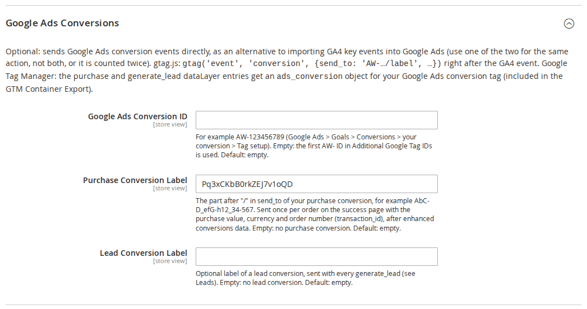
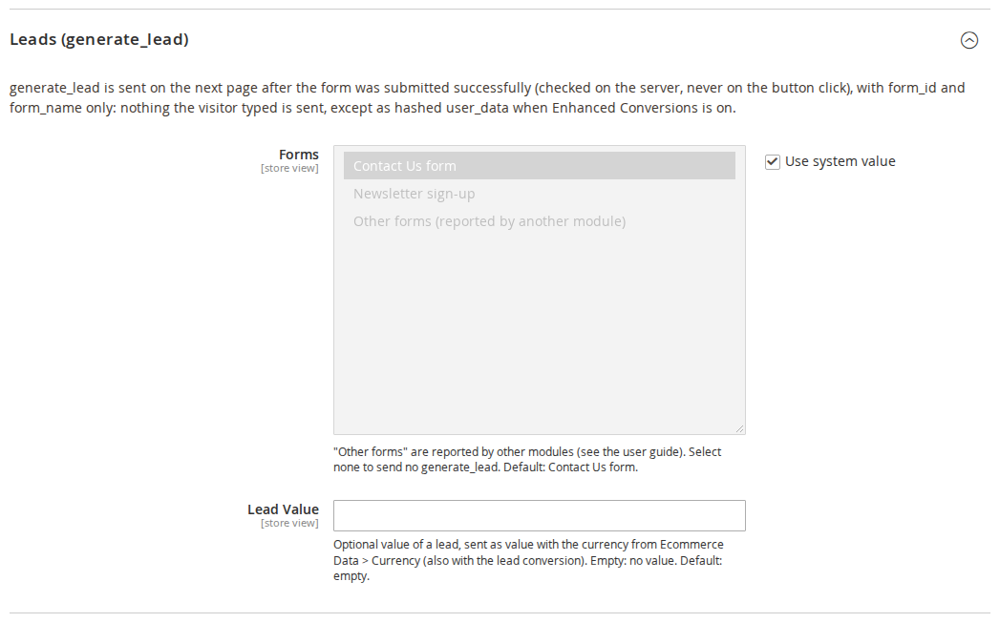
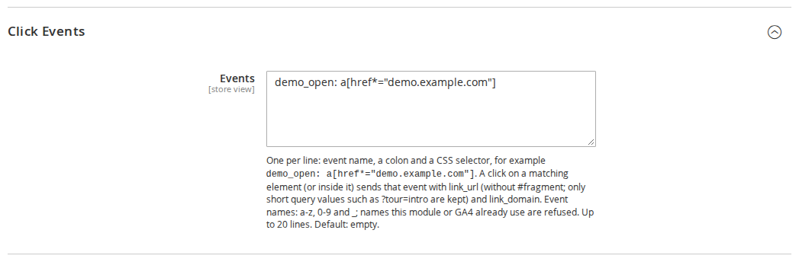

# GA4 & Google Tag Manager for Magento 2: User Guide

GA4 ecommerce tracking for Luma and Hyvä: Google Tag Manager or gtag.js, a complete GA4 dataLayer, Google Consent
Mode, refunds sent from the server through the Measurement Protocol, and a GTM container you can import in one step.
This guide covers installation, every setting and day-to-day use.

- Admin demo: https://demo.commercegears.com/try-admin/ga4-gtm
- Composer access: https://commercegears.com/composer-access/
- Changelog: [CHANGELOG.md](../CHANGELOG.md) · Questions: [FAQ](faq.md)


## 1. Requirements

| | |
| --- | --- |
| Magento | Open Source or Adobe Commerce 2.4.6 to 2.4.9 |
| PHP | 8.2 to 8.5 (Magento 2.4.6: PHP 8.2) |
| Themes | Luma, Blank and themes based on them; Hyvä 1.3+ (no compatibility module needed) |
| Other | `commercegears/module-core` (installed automatically) |
| Optional | `commercegears/module-cookie-consent` for the consent banner and "load after consent" |
| Google | A GTM container ID and/or a GA4 measurement ID; a Measurement Protocol API secret for refunds |

## 2. Installation

With Composer. Use the Composer keys from your account on commercegears.com (see
https://commercegears.com/composer-access/):

```bash
composer config repositories.commercegears composer https://repo.commercegears.com
composer config --auth http-basic.repo.commercegears.com PUBLIC_KEY PRIVATE_KEY
composer require commercegears/module-ga4-gtm
bin/magento setup:upgrade
bin/magento setup:di:compile            # production mode only
bin/magento setup:static-content:deploy # production mode only
bin/magento cache:flush
```

To update later: `composer update commercegears/module-ga4-gtm`, then the same `bin/magento` commands.

Magento cron must run (it sends the refunds). Nothing else is needed on Hyvä: the module ships its own Hyvä layout
handles.

## 3. Quick start with Google Tag Manager

1. Go to **Stores > Configuration > CommerceGears > GA4 & Google Tag Manager** (also under **CommerceGears > GA4 & GTM >
   Settings**).
2. **General > Enabled = Yes**, **Tag Type = Google Tag Manager**.
3. Enter your **GTM Container ID** (for example GTM-AB12CDE) and your **GA4 Measurement ID** (for example
   G-AB12CD34EF). Save and flush the cache.
4. Open **CommerceGears > GA4 & GTM > GTM Container Export**, pick the store view in **Settings From** and click
   **Download GTM Container JSON**.
5. In Google Tag Manager open **Admin > Import Container**, choose the file, your workspace, **Merge** and "Rename
   conflicting tags, triggers and variables". Check the measurement ID in the variable "Const - GA4 Measurement ID",
   preview the container on your shop, then publish.

With gtag.js instead: set **Tag Type = gtag.js (GA4 directly)** and the measurement ID; there is no container to
import.


## 4. Settings

All settings are under **Stores > Configuration > CommerceGears > GA4 & Google Tag Manager** and can be set per website
and per store view.

### General


| Setting | What it does |
| --- | --- |
| Enabled | Adds the tag and the ecommerce events to the storefront. Default: No. |
| Tag Type | **Google Tag Manager**: events go to the dataLayer for your GTM tags. **gtag.js (GA4 directly)**: events are sent straight to GA4. |
| GTM Container ID | For example GTM-AB12CDE (top of your GTM workspace). Shown for Google Tag Manager only. The placeholder GTM-XXXXXXX is refused. |
| GTM Script Domain | Change only for server-side tagging (for example https://sgtm.example.com). Default: https://www.googletagmanager.com |
| GA4 Measurement ID | For example G-AB12CD34EF (GA4 Admin > Data streams). Required for gtag.js and refunds; also written into the GTM container export. The placeholder G-XXXXXXXXXX is refused. |
| Additional Google Tag IDs | Shown for gtag.js only. Comma-separated IDs such as AW-123456789 (Google Ads), G- (another GA4 property), DC- (Floodlight) or GT- (Google tag). Each gets `gtag('config', ID)` after the GA4 measurement ID, so the Google Ads conversion linker can store the ad click when ad_storage consent is granted. Ecommerce events still go to GA4 only. Up to 10 IDs; anything else is refused when saved. Default: empty. |
| Load Tags | **Immediately (Google Consent Mode)** (default), **After "Analytics" consent** or **After "Marketing" consent**. The two "after" options need CommerceGears Cookie Consent and are ignored when it is disabled. |
| Consent Mode Defaults (Without CommerceGears Cookie Consent) | **Do not set (consent tool sets them)**, **Denied until updated** or **Granted (no consent required)**. Only used when CommerceGears Cookie Consent is not enabled. |
| Debug Mode | Logs every event to the browser console and adds debug_mode so events show in GA4 DebugView. Switch off on live stores. |

### Ecommerce Data


| Setting | What it does |
| --- | --- |
| Item ID | **SKU** or **Product ID**. Use the same identifier as your Google Merchant Center feed. Configurable products report the parent; the chosen variant SKU goes into item_variant. |
| Brand Attribute | Product attribute for item_brand. Default: Manufacturer. |
| Default Brand | Used when the product has no brand value. Leave empty to omit item_brand. |
| Item Categories | **Deepest assigned category (full path)** or **First assigned category (full path)**, sent as item_category to item_category5 (root category excluded). |
| Affiliation | Sent with purchases and items. Empty uses the store view name. |
| Currency | **Currency the customer sees (order currency)** (default) or **Base currency**, for value, price and tax in all events. |
| Item Prices Include Tax | Item prices in events include tax. Default: No. |
| Purchase Value Includes Tax | The value is the order grand total after discounts. **No** leaves tax out (net revenue). Tax is always sent separately in the tax parameter as well. Default: Yes. |
| Purchase Value Includes Shipping | Whether value includes shipping. Shipping is always sent separately in the shipping parameter as well. Default: Yes. |
| Skip Zero-value Orders | **Yes**: no purchase event for orders whose purchase value is 0 (for example free products). The order is still marked as handled, so it is never sent later. Default: No. |
| Maximum Items per view_item_list | Keeps the dataLayer small on long category pages. Default: 50; GA4 accepts up to 200. |
| Enhanced Conversions (user_data) | Adds SHA-256 hashed email, phone, name and street (plus city, region, postcode and country) as user_data to purchase, sign_up, login and generate_lead (and to the Google Ads conversions). With CommerceGears Cookie Consent it is only set after the visitor accepts Marketing (ad_user_data). Only enable if your privacy policy covers it. Default: No. |

### Google Ads Conversions



| Setting | What it does |
| --- | --- |
| Google Ads Conversion ID | Your Google Ads tag ID, for example AW-123456789 (Google Ads > Goals > Conversions > your conversion > Tag setup). Empty: the first AW- ID in **Additional Google Tag IDs** is used. A pasted `AW-123456789/label` keeps the ID. Default: empty. |
| Purchase Conversion Label | The part after "/" in `send_to` of your purchase conversion action. When set, the order success page sends a Google Ads conversion once per order, with the same value, currency and order number (transaction_id) as the GA4 purchase. Empty: no purchase conversion. Default: empty. |
| Lead Conversion Label | Optional label of a lead conversion action, sent with every generate_lead (see Leads). Default: empty. |

Labels may contain letters, digits, "-" and "_"; anything else is refused when saved. See
[Google Ads conversion tags](#google-ads-conversion-tags-direct) below.

### Leads (generate_lead)



| Setting | What it does |
| --- | --- |
| Forms | Forms whose successful submission sends GA4 `generate_lead`: **Contact Us form** (default), **Newsletter sign-up**, **Other forms (reported by another module)**. Select none to send no generate_lead. |
| Lead Value | Optional value of a lead, sent as `value` with the currency from **Ecommerce Data > Currency** (also with the lead conversion). Empty: no value and no currency. Default: empty. |

generate_lead is only sent when Magento has accepted the form on the server (the contact message was handed over for
sending, the newsletter subscription was saved), never on the button click, so a form with errors or a spam
submission is not counted. It is queued on the server and sent on the next page, once. The parameters are `form_id`
(`contact`, `newsletter`), `form_name` (`Contact Us`, `Newsletter`) and, when a module passes one, `lead_source`.
Nothing the visitor typed is sent in parameters or URLs; the email and phone number only go into the hashed user_data
when **Enhanced Conversions** is on.

### Click Events



| Setting | What it does |
| --- | --- |
| Events | One rule per line: an event name, a colon and a CSS selector, for example `demo_open: a[href*="demo.example.com"]`. A click on a matching element (or anything inside it) sends that GA4 event with `link_url` and `link_domain` of the link. Up to 20 lines. Default: empty. |

- Event names use a-z, 0-9 and "_" (up to 40 characters, starting with a letter). Names this module already sends
  (purchase, generate_lead, add_to_cart, ...) and names GA4 reserves (page_view, session_start, names starting with
  `google_`, ...) are refused, so a click can never be counted as a sale or a lead.
- `link_url` leaves out the #fragment and every query parameter except short codes (letters, digits, "-", "_", ".")
  whose name does not look personal (email, name, phone, token, ...), so `?tour=intro&utm_source=shop` is kept and
  `?email=...` is dropped. mailto: and tel: links send no link_url.
- To use the event as a Google Ads conversion, mark it as a key event in GA4 and import it into Google Ads.

### Refunds (Measurement Protocol)


| Setting | What it does |
| --- | --- |
| Send Refunds | Sends a refund event for every credit memo. Needs the GA4 Measurement ID and an API secret. Default: No. |
| API Secret | GA4 Admin > Data streams > your web stream > Measurement Protocol API secrets. Stored encrypted. |

## 5. The events

| Event | When | Theme |
| --- | --- | --- |
| view_item_list | Category pages, search results, related, upsell and cross-sell lists | Luma and Hyvä |
| select_item | A click on a product link inside one of these lists | Luma and Hyvä |
| view_item | Product page | Luma and Hyvä |
| add_to_cart / remove_from_cart | Any cart change: product page, AJAX add from a list, mini-cart, cart page quantity or remove, wish list, reorder | Luma and Hyvä |
| add_to_wishlist | A product added to the wish list | Luma and Hyvä |
| view_cart | Cart page | Luma and Hyvä |
| begin_checkout | Checkout page | Magento checkout |
| add_shipping_info / add_payment_info | Shipping method and payment method chosen in the checkout | Magento checkout |
| purchase | Order success page, once per order | All |
| refund | Credit memo created (sent from the server) | Not in the browser |
| login / sign_up / search | Customer login, registration, search results page | Luma and Hyvä |
| generate_lead | The page after a successful Contact Us form or newsletter sign-up (see Leads) | Luma and Hyvä |
| your click events (for example demo_open) | A click on an element matching a Click Events rule | Luma and Hyvä |
| Google Ads conversion | Right after purchase / generate_lead, when a conversion label is set | All |


### How events reach the dataLayer

- Page events (view_item_list, view_item, view_cart, begin_checkout, purchase, search) are printed in the page as
  JSON and pushed when the page loads.
- Events that belong to the visitor (cart changes, wish list, login, sign-up) are queued on the server and delivered
  through the private customer-data section `commercegears-ga4`, so they work with the full-page cache.
- Cart changes are detected by comparing each cart line with its stored quantity. An AJAX add and a full page reload
  are both counted once, and a guest cart merged at login is not counted.
- Every event has an id, and the browser remembers the ids it has already pushed. If a page navigates away before the
  section response arrives, the next page fetches the section once.
- Purchase is flagged in the table `commercegears_ga4_order` before it is output, so a reload, the back button or a
  second tab never repeat it. transaction_id is the order number, value, tax, shipping, currency and items come from
  the order on the server (never from the URL).
- Cart events use the cart's own currency. Lines with a custom price (for example free gifts) are reported at that
  price, even when it is 0.

To check the events, switch on **Debug Mode** and open the browser console: every push is logged as
`[CommerceGears GA4] <event>`. You can also inspect `window.dataLayer`, or use GTM Preview and GA4 DebugView.


## 6. Consent

- **With CommerceGears Cookie Consent**: the Consent Mode defaults come from that module and are printed before the tag.
  Nothing else is needed. The GTM `<noscript>` iframe is left out, because a visitor without JavaScript cannot give
  consent. With **Load Tags = After "Analytics" consent** (or Marketing), GTM or gtag.js is loaded only after the
  visitor accepts that category.
- **With another consent tool**: set **Consent Mode Defaults** to **Denied until updated** if your tool sends
  `gtag('consent', 'update', ...)` but does not set the defaults itself, or **Do not set** if it sets them.
- **Without consent requirements**: choose **Granted (no consent required)**.

The defaults cover ad_storage, ad_user_data, ad_personalization, analytics_storage, functionality_storage and
personalization_storage. With **Load Tags = Immediately** (advanced Consent Mode) gtag.js or GTM loads with the denied
defaults: Google receives cookieless pings (`gcs=G100`) and sets no `_ga` or `_gcl` cookies until the visitor
accepts. On later pages the stored choice is sent as a consent update before the tag loads. For enhanced conversions
the CommerceGears Cookie Consent Marketing category must be shown (Cookie Categories > Show Marketing). The GTM container includes a trigger "CE - commercegears_consent_update" and variables for the
CommerceGears Cookie Consent categories, for your own tags that should wait for consent.

### Google Ads conversions from GA4

To count Google Ads conversions from your GA4 purchases (Google Ads > Goals > Conversions > Import > Google Analytics
4 properties > purchase):

1. **Tag Type = gtag.js (GA4 directly)** and your **GA4 Measurement ID**.
2. **Additional Google Tag IDs** = your Google Ads ID (for example AW-123456789, shown in Google Ads under the Google
   tag). The module adds `gtag('config', 'AW-...')` after the GA4 config, so the conversion linker keeps the ad click
   in the `_gcl_au`/`_gcl_aw` cookies, which Google needs to link the GA4 purchase to the ad. These cookies are only
   set when ad_storage is granted; Consent Mode takes care of that.
3. Leave out any Google Ads conversion event snippet: the purchase comes from GA4. The module sends its ecommerce
   events to the GA4 measurement IDs only, so Google Ads never counts them a second time.
4. Optional: **Purchase Value Includes Tax = No** (and Shipping = No) to bid on net revenue, **Skip Zero-value Orders =
   Yes** to leave free orders out, and **Enhanced Conversions (user_data) = Yes**.

With Google Tag Manager the setting is ignored: add a Conversion Linker tag (or a Google tag with your AW- ID) to your
container instead.

### Google Ads conversion tags (direct)

Instead of importing GA4 key events, you can send Google Ads conversions directly. Use one of the two ways for the same
action, not both, or Google Ads counts it twice.

1. In Google Ads create a purchase conversion action (and optionally a lead one) with "Google tag" / "event snippet"
   set-up and copy the `send_to` value, for example `AW-123456789/AbC-D_efG-h12`.
2. Enter the ID part in **Google Ads Conversion ID** (or leave it empty when that AW- ID is already in **Additional
   Google Tag IDs**) and the label in **Purchase Conversion Label** / **Lead Conversion Label**.

**gtag.js**: the AW- ID is configured on every page (conversion linker), and on the success page the module sends,
once per order:

```js
gtag('set', 'user_data', {...});            // only with Enhanced Conversions and ad_user_data consent
gtag('event', 'purchase', {...});           // GA4, send_to = the GA4 measurement IDs
gtag('event', 'conversion', {send_to: 'AW-123456789/AbC-D_efG-h12', value: 75.00, currency: 'GBP', transaction_id: '000000501'});
```

The conversion uses exactly the purchase's value, currency and transaction_id (so **Purchase Value Includes Tax /
Shipping** and **Skip Zero-value Orders** apply to it too) and travels inside the purchase event: the same "already
sent" mark on the order and in the browser covers both, so a reload, the back button or a second tab repeat neither.
The lead conversion follows generate_lead the same way (`value`/`currency` only when a Lead Value is set).

**Google Tag Manager**: the purchase and generate_lead dataLayer entries get an `ads_conversion` object
(`send_to`, `value`, `currency`, `transaction_id`), which is cleared again right after that entry. When a label is set,
the GTM Container Export adds a Conversion Linker tag and a Google Ads Conversion Tracking tag per label, reading
`ads_conversion.value`, `.currency` and `.transaction_id`. To use enhanced conversions in GTM, switch on "Include
user-provided data" in that tag and point it at the `user_data` of the same entry.

### Enhanced conversions

With **Enhanced Conversions (user_data) = Yes** the purchase carries user_data built from the order:
`sha256_email_address` (lower case, no spaces, dots before @gmail.com and @googlemail.com removed),
`sha256_phone_number` (E.164, for example +447700900123; national numbers are converted with the address country for
EU/EEA countries, the UK, Switzerland, Türkiye, the US, Canada, Australia and New Zealand), and in `address`
`sha256_first_name`, `sha256_last_name`, `sha256_street` (lower case, symbols removed) plus `city`, `region`,
`postal_code` and `country` in plain text. All hashes are SHA-256 in hex.

With CommerceGears Cookie Consent, user_data is only set once the visitor has granted ad_user_data (the Marketing
category):

- gtag.js: `gtag('set', 'user_data', ...)` right before the purchase (or generate_lead) event, so it is also set before
  the Google Ads conversion that follows it.
- Google Tag Manager: `user_data` in the purchase dataLayer entry (use it in a "User-Provided Data" variable).
- Consent given later on the success page: user_data is set then (in GTM as a `commercegears_user_data` dataLayer
  event); the purchase itself is not sent again.

Without consent nothing is put in the dataLayer, the URL or a log. Without CommerceGears Cookie Consent the data is
set as before; your consent tool and Google Consent Mode decide how it may be used.

## 7. Refunds

1. Create a GA4 Measurement Protocol API secret (GA4 Admin > Data streams > your web stream).
2. In **Refunds (Measurement Protocol)** set **Send Refunds = Yes** and paste the **API Secret**. The
   **GA4 Measurement ID** in General must be set.
3. From then on, every credit memo queues a refund event with the order number as transaction_id, the value, tax,
   shipping, affiliation and the refunded items. Cron sends queued refunds every five minutes.

The GA client ID and session ID are saved when the order is placed, so GA4 can link the refund to the visitor. If no
client ID was available (consent denied, orders created in the admin), a generated one is used: the refund is
attributed to the transaction but not to a session. The refund value follows the purchase value settings (tax and
shipping), so a full refund cancels the purchase revenue exactly. A failed send is retried up to five times, and a
refund is claimed before it is sent, so cron and the CLI cannot send it twice.

## 8. CLI commands

| Command | What it does |
| --- | --- |
| `bin/magento commercegears:ga4:refunds` | Lists queued refunds. |
| `bin/magento commercegears:ga4:refunds --dry-run` | Prints the Measurement Protocol payloads without sending them. |
| `bin/magento commercegears:ga4:refunds --send` | Sends pending refunds now (cron does this every five minutes). |
| `bin/magento commercegears:ga4:gtm-export [--store=default] [--output=container.json]` | Writes the GTM container JSON, using the measurement ID of that store view. An unknown store view is an error. |

## 9. For developers

- Push your own events in the browser: `window.swGa4.push('event_name', {currency: 'GBP', value: 10, items: [...]})`.
- Queue an event on the server (delivered on the next section load):
  `CommerceGears\Ga4\Model\EventQueue::add($event, $params)`.
- Register a product list for view_item_list and select_item:
  `CommerceGears\Ga4\Model\ListRegistry::add($id, $name, $products)`.
- Add page events: implement `CommerceGears\Ga4\Api\PageEventProviderInterface` and add it to the `providers` argument
  of the block `commercegears.ga4.datalayer` in a layout handle.
- Build items: `CommerceGears\Ga4\Model\ItemBuilder::fromProduct()`, `fromQuoteItem()`, `fromOrderItem()`.
- Report a lead from your own form after it was saved successfully (needs **Leads > Forms = Other forms**):
  `CommerceGears\Ga4\Model\LeadTracker::track('quote_request', 'Quote request', 'product page', $email)`, or dispatch the
  event `commercegears_ga4_lead` with `form_id`, `form_name` and optionally `lead_source`, `email`, `telephone` (email
  and phone are only used hashed for user_data). The Lead Value and Lead Conversion Label apply.

## 10. Permissions (ACL)

Under **System > Permissions > User Roles > Role Resources > CommerceGears > GA4 & GTM**:

| Resource | Gives access to |
| --- | --- |
| `CommerceGears_Ga4::export` | GTM Container Export |
| `CommerceGears_Ga4::config` | The GA4 & Google Tag Manager settings |

## 11. Troubleshooting

- **No events in the dataLayer**: check **Enabled** for the store view, the container or measurement ID, and flush
  the cache. With **Load Tags** set to an "after consent" option, nothing loads until the visitor accepts that
  category.
- **Events in the dataLayer but not in GA4**: with GTM, the container must be published and contain the GA4 tags
  (import the export file). Use GTM Preview and GA4 DebugView with **Debug Mode = Yes**.
- **No add_shipping_info or add_payment_info**: these are implemented for the Magento (Luma) checkout. A one-step
  checkout needs an adapter that calls `window.swGa4.push()`. add_payment_info also fires for a method the checkout
  pre-selects.
- **A CMS product widget sends no view_item_list**: its block HTML is cached, so these lists are not reported.
- **Refunds are not arriving**: check **Send Refunds**, the API secret and the measurement ID, make sure Magento cron
  runs, then run `bin/magento commercegears:ga4:refunds` to see the queue and its last error. `--dry-run` shows the
  payload.
- **Enhanced conversions without phone numbers**: Google requires E.164. Numbers in international format (+44...) and
  national numbers of the supported countries (see Enhanced conversions) are converted; others are left out.
- **No user_data at all**: with CommerceGears Cookie Consent it waits for Marketing consent. Check that the Marketing
  category is shown and accepted.
- **No _gcl_au cookie**: the visitor has not granted ad_storage (Marketing), or Tag Type is Google Tag Manager (add a
  Conversion Linker tag in GTM).

## 12. Uninstall

```bash
bin/magento module:disable CommerceGears_Ga4
composer remove commercegears/module-ga4-gtm
bin/magento setup:upgrade
bin/magento cache:flush
```

Then remove the imported tags from your GTM container if you no longer need them. The tables `commercegears_ga4_order`
and `commercegears_ga4_refund` can be dropped once the module is removed.
