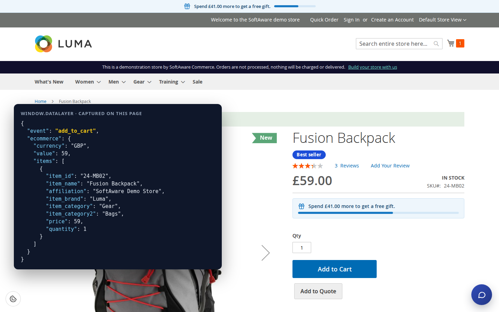
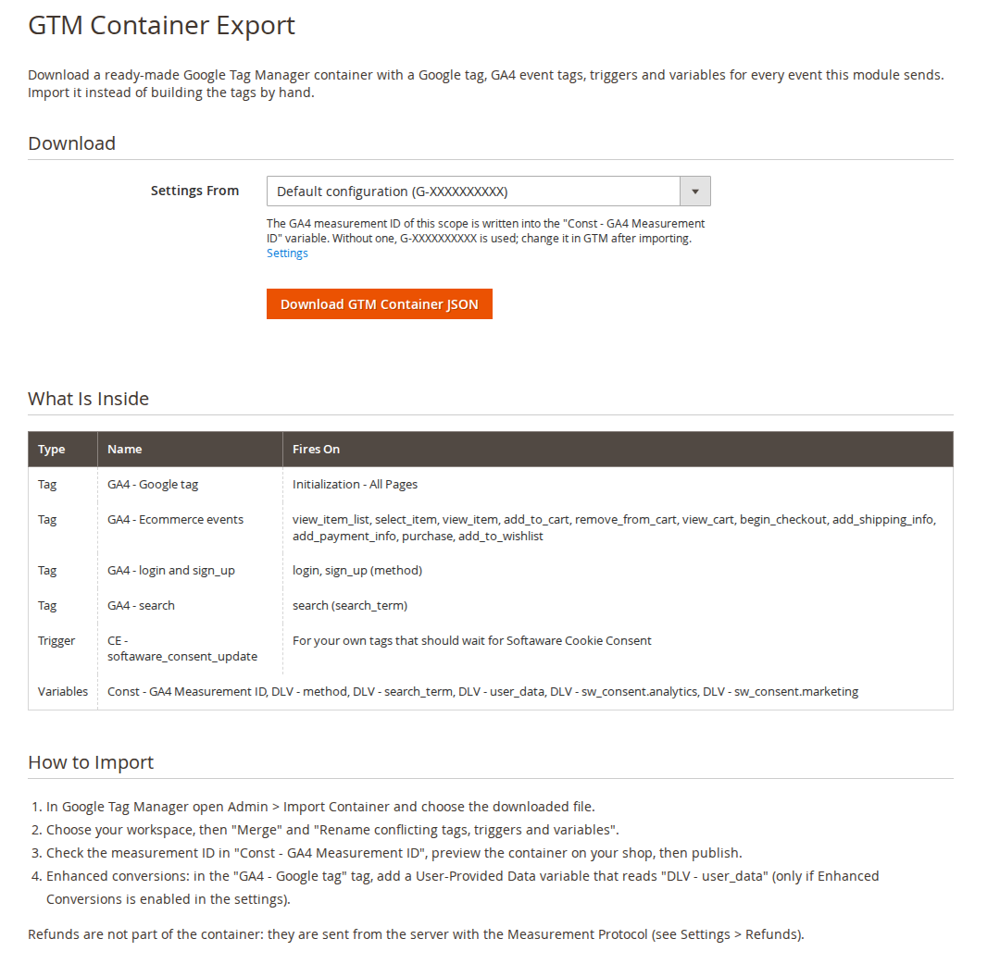
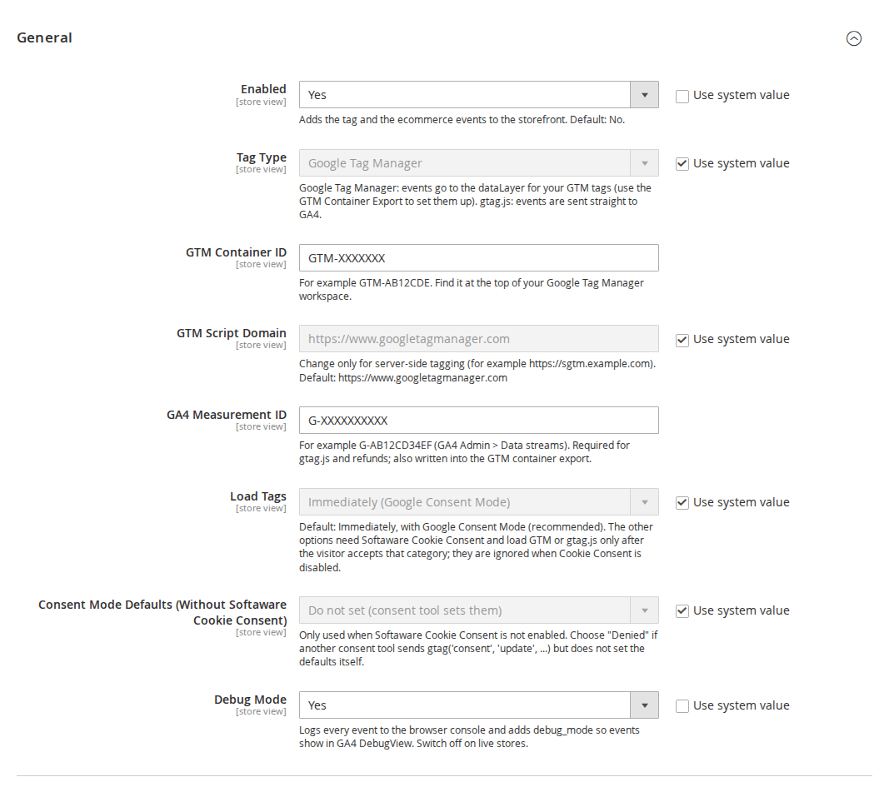
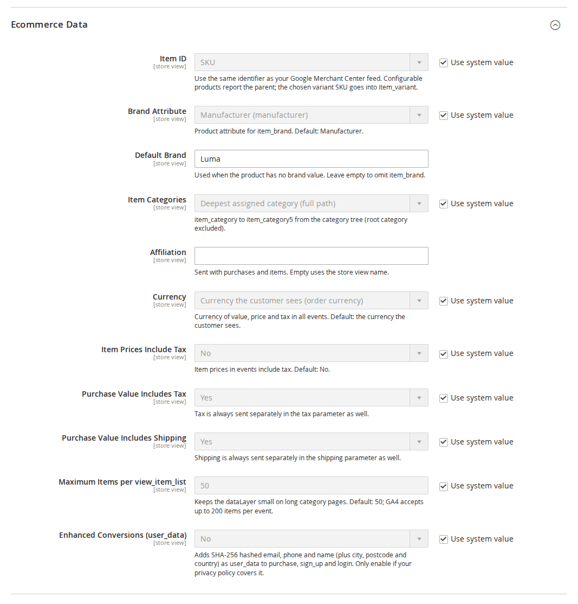
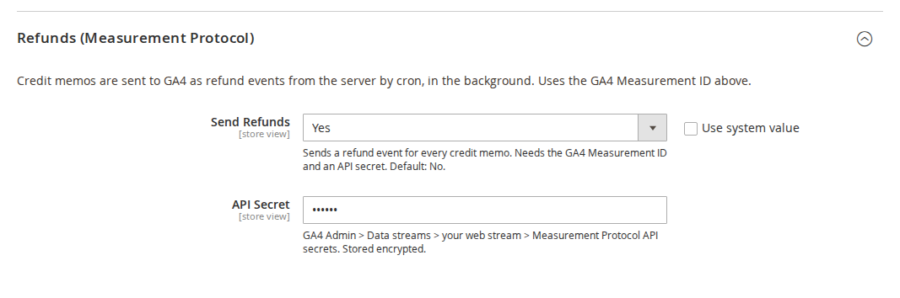
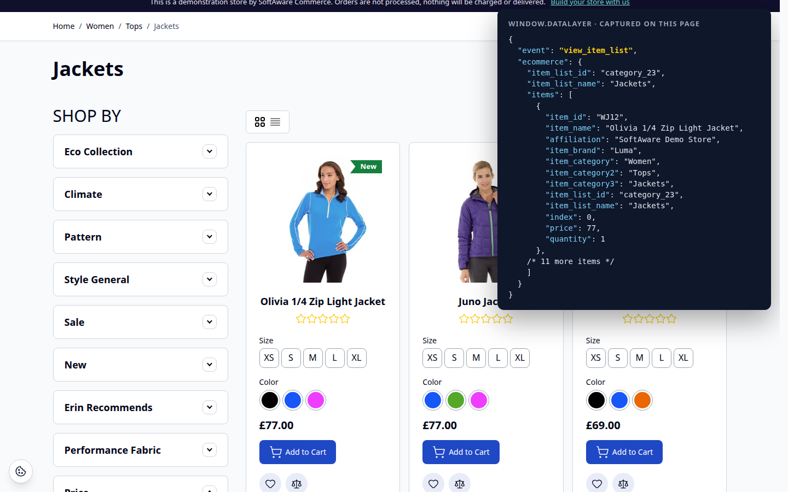
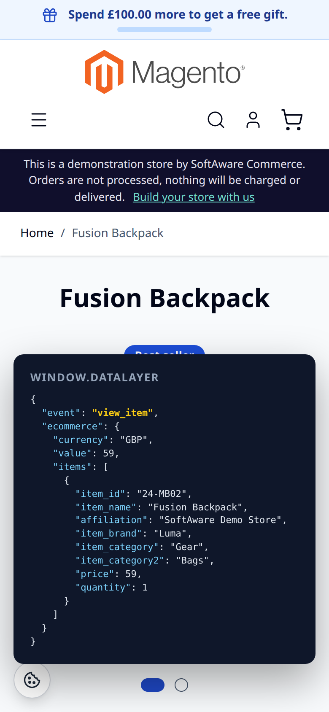

# GA4 & Google Tag Manager for Magento 2: User Guide

GA4 ecommerce tracking for Luma and Hyvä: Google Tag Manager or gtag.js, a complete GA4 dataLayer, Google Consent
Mode, refunds sent from the server through the Measurement Protocol, and a GTM container you can import in one step.
This guide covers installation, every setting and day-to-day use.

- Admin demo: https://demo.softawarecommerce.com/try-admin/ga4-gtm
- Composer access: https://softawarecommerce.com/shop/composer-access/
- Changelog: [CHANGELOG.md](../CHANGELOG.md) · Questions: [FAQ](faq.md)



## 1. Requirements

| | |
| --- | --- |
| Magento | Open Source or Adobe Commerce 2.4.7 to 2.4.9 |
| PHP | 8.2 to 8.5 |
| Themes | Luma, Blank and themes based on them; Hyvä 1.3+ (no compatibility module needed) |
| Other | `softaware/module-core` (installed automatically) |
| Optional | `softaware/module-cookie-consent` for the consent banner and "load after consent" |
| Google | A GTM container ID and/or a GA4 measurement ID; a Measurement Protocol API secret for refunds |

## 2. Installation

With Composer. Use the Composer keys from your account on softawarecommerce.com (see
https://softawarecommerce.com/shop/composer-access/):

```bash
composer config repositories.softaware composer https://repo.softawarecommerce.com
composer config --auth http-basic.repo.softawarecommerce.com PUBLIC_KEY PRIVATE_KEY
composer require softaware/module-ga4-gtm
bin/magento setup:upgrade
bin/magento setup:di:compile            # production mode only
bin/magento setup:static-content:deploy # production mode only
bin/magento cache:flush
```

To update later: `composer update softaware/module-ga4-gtm`, then the same `bin/magento` commands.

Magento cron must run (it sends the refunds). Nothing else is needed on Hyvä: the module ships its own Hyvä layout
handles.

## 3. Quick start with Google Tag Manager

1. Go to **Stores > Configuration > Softaware > GA4 & Google Tag Manager** (also under **Softaware > GA4 & GTM >
   Settings**).
2. **General > Enabled = Yes**, **Tag Type = Google Tag Manager**.
3. Enter your **GTM Container ID** (for example GTM-AB12CDE) and your **GA4 Measurement ID** (for example
   G-AB12CD34EF). Save and flush the cache.
4. Open **Softaware > GA4 & GTM > GTM Container Export**, pick the store view in **Settings From** and click
   **Download GTM Container JSON**.
5. In Google Tag Manager open **Admin > Import Container**, choose the file, your workspace, **Merge** and "Rename
   conflicting tags, triggers and variables". Check the measurement ID in the variable "Const - GA4 Measurement ID",
   preview the container on your shop, then publish.

With gtag.js instead: set **Tag Type = gtag.js (GA4 directly)** and the measurement ID; there is no container to
import.



## 4. Settings

All settings are under **Stores > Configuration > Softaware > GA4 & Google Tag Manager** and can be set per website
and per store view.

### General



| Setting | What it does |
| --- | --- |
| Enabled | Adds the tag and the ecommerce events to the storefront. Default: No. |
| Tag Type | **Google Tag Manager**: events go to the dataLayer for your GTM tags. **gtag.js (GA4 directly)**: events are sent straight to GA4. |
| GTM Container ID | For example GTM-AB12CDE (top of your GTM workspace). Shown for Google Tag Manager only. |
| GTM Script Domain | Change only for server-side tagging (for example https://sgtm.example.com). Default: https://www.googletagmanager.com |
| GA4 Measurement ID | For example G-AB12CD34EF (GA4 Admin > Data streams). Required for gtag.js and refunds; also written into the GTM container export. |
| Load Tags | **Immediately (Google Consent Mode)** (default), **After "Analytics" consent** or **After "Marketing" consent**. The two "after" options need Softaware Cookie Consent and are ignored when it is disabled. |
| Consent Mode Defaults (Without Softaware Cookie Consent) | **Do not set (consent tool sets them)**, **Denied until updated** or **Granted (no consent required)**. Only used when Softaware Cookie Consent is not enabled. |
| Debug Mode | Logs every event to the browser console and adds debug_mode so events show in GA4 DebugView. Switch off on live stores. |

### Ecommerce Data



| Setting | What it does |
| --- | --- |
| Item ID | **SKU** or **Product ID**. Use the same identifier as your Google Merchant Center feed. Configurable products report the parent; the chosen variant SKU goes into item_variant. |
| Brand Attribute | Product attribute for item_brand. Default: Manufacturer. |
| Default Brand | Used when the product has no brand value. Leave empty to omit item_brand. |
| Item Categories | **Deepest assigned category (full path)** or **First assigned category (full path)**, sent as item_category to item_category5 (root category excluded). |
| Affiliation | Sent with purchases and items. Empty uses the store view name. |
| Currency | **Currency the customer sees (order currency)** (default) or **Base currency**, for value, price and tax in all events. |
| Item Prices Include Tax | Item prices in events include tax. Default: No. |
| Purchase Value Includes Tax | Whether value includes tax. Tax is always sent separately in the tax parameter as well. |
| Purchase Value Includes Shipping | Whether value includes shipping. Shipping is always sent separately in the shipping parameter as well. |
| Maximum Items per view_item_list | Keeps the dataLayer small on long category pages. Default: 50; GA4 accepts up to 200. |
| Enhanced Conversions (user_data) | Adds SHA-256 hashed email, phone and name (plus city, postcode and country) as user_data to purchase, sign_up and login. Only enable if your privacy policy covers it. |

### Refunds (Measurement Protocol)



| Setting | What it does |
| --- | --- |
| Send Refunds | Sends a refund event for every credit memo. Needs the GA4 Measurement ID and an API secret. Default: No. |
| API Secret | GA4 Admin > Data streams > your web stream > Measurement Protocol API secrets. Stored encrypted. |

## 5. The events

| Event | When | Theme |
| --- | --- | --- |
| view_item_list | Category pages, search results, related, upsell and cross-sell lists | Luma and Hyvä |
| select_item | A click on a product link inside one of these lists | Luma and Hyvä |
| view_item | Product page | Luma and Hyvä |
| add_to_cart / remove_from_cart | Any cart change: product page, AJAX add from a list, mini-cart, cart page quantity or remove, wish list, reorder | Luma and Hyvä |
| add_to_wishlist | A product added to the wish list | Luma and Hyvä |
| view_cart | Cart page | Luma and Hyvä |
| begin_checkout | Checkout page | Magento checkout |
| add_shipping_info / add_payment_info | Shipping method and payment method chosen in the checkout | Magento checkout |
| purchase | Order success page, once per order | All |
| refund | Credit memo created (sent from the server) | Not in the browser |
| login / sign_up / search | Customer login, registration, search results page | Luma and Hyvä |



### How events reach the dataLayer

- Page events (view_item_list, view_item, view_cart, begin_checkout, purchase, search) are printed in the page as
  JSON and pushed when the page loads.
- Events that belong to the visitor (cart changes, wish list, login, sign-up) are queued on the server and delivered
  through the private customer-data section `softaware-ga4`, so they work with the full-page cache.
- Cart changes are detected by comparing each cart line with its stored quantity. An AJAX add and a full page reload
  are both counted once, and a guest cart merged at login is not counted.
- Every event has an id, and the browser remembers the ids it has already pushed. If a page navigates away before the
  section response arrives, the next page fetches the section once.
- Purchase is flagged in the table `softaware_ga4_order` and never output twice for the same order.
- Cart events use the cart's own currency. Lines with a custom price (for example free gifts) are reported at that
  price, even when it is 0.

To check the events, switch on **Debug Mode** and open the browser console: every push is logged as
`[Softaware GA4] <event>`. You can also inspect `window.dataLayer`, or use GTM Preview and GA4 DebugView.



## 6. Consent

- **With Softaware Cookie Consent**: the Consent Mode defaults come from that module and are printed before the tag.
  Nothing else is needed. The GTM `<noscript>` iframe is left out, because a visitor without JavaScript cannot give
  consent. With **Load Tags = After "Analytics" consent** (or Marketing), GTM or gtag.js is loaded only after the
  visitor accepts that category.
- **With another consent tool**: set **Consent Mode Defaults** to **Denied until updated** if your tool sends
  `gtag('consent', 'update', ...)` but does not set the defaults itself, or **Do not set** if it sets them.
- **Without consent requirements**: choose **Granted (no consent required)**.

The defaults cover ad_storage, ad_user_data, ad_personalization, analytics_storage, functionality_storage and
personalization_storage. The GTM container includes a trigger "CE - softaware_consent_update" and variables for the
Softaware Cookie Consent categories, for your own tags that should wait for consent.

## 7. Refunds

1. Create a GA4 Measurement Protocol API secret (GA4 Admin > Data streams > your web stream).
2. In **Refunds (Measurement Protocol)** set **Send Refunds = Yes** and paste the **API Secret**. The
   **GA4 Measurement ID** in General must be set.
3. From then on, every credit memo queues a refund event with the order number as transaction_id, the value, tax,
   shipping, affiliation and the refunded items. Cron sends queued refunds every five minutes.

The GA client ID and session ID are saved when the order is placed, so GA4 can link the refund to the visitor. If no
client ID was available (consent denied, orders created in the admin), a generated one is used: the refund is
attributed to the transaction but not to a session. The refund value follows the purchase value settings (tax and
shipping), so a full refund cancels the purchase revenue exactly. A failed send is retried up to five times, and a
refund is claimed before it is sent, so cron and the CLI cannot send it twice.

## 8. CLI commands

| Command | What it does |
| --- | --- |
| `bin/magento softaware:ga4:refunds` | Lists queued refunds. |
| `bin/magento softaware:ga4:refunds --dry-run` | Prints the Measurement Protocol payloads without sending them. |
| `bin/magento softaware:ga4:refunds --send` | Sends pending refunds now (cron does this every five minutes). |
| `bin/magento softaware:ga4:gtm-export [--store=default] [--output=container.json]` | Writes the GTM container JSON, using the measurement ID of that store view. |

## 9. For developers

- Push your own events in the browser: `window.swGa4.push('event_name', {currency: 'GBP', value: 10, items: [...]})`.
- Queue an event on the server (delivered on the next section load):
  `Softaware\Ga4\Model\EventQueue::add($event, $params)`.
- Register a product list for view_item_list and select_item:
  `Softaware\Ga4\Model\ListRegistry::add($id, $name, $products)`.
- Add page events: implement `Softaware\Ga4\Api\PageEventProviderInterface` and add it to the `providers` argument
  of the block `softaware.ga4.datalayer` in a layout handle.
- Build items: `Softaware\Ga4\Model\ItemBuilder::fromProduct()`, `fromQuoteItem()`, `fromOrderItem()`.

## 10. Permissions (ACL)

Under **System > Permissions > User Roles > Role Resources > Softaware > GA4 & GTM**:

| Resource | Gives access to |
| --- | --- |
| `Softaware_Ga4::export` | GTM Container Export |
| `Softaware_Ga4::config` | The GA4 & Google Tag Manager settings |

## 11. Troubleshooting

- **No events in the dataLayer**: check **Enabled** for the store view, the container or measurement ID, and flush
  the cache. With **Load Tags** set to an "after consent" option, nothing loads until the visitor accepts that
  category.
- **Events in the dataLayer but not in GA4**: with GTM, the container must be published and contain the GA4 tags
  (import the export file). Use GTM Preview and GA4 DebugView with **Debug Mode = Yes**.
- **No add_shipping_info or add_payment_info**: these are implemented for the Magento (Luma) checkout. A one-step
  checkout needs an adapter that calls `window.swGa4.push()`. add_payment_info also fires for a method the checkout
  pre-selects.
- **A CMS product widget sends no view_item_list**: its block HTML is cached, so these lists are not reported.
- **Refunds are not arriving**: check **Send Refunds**, the API secret and the measurement ID, make sure Magento cron
  runs, then run `bin/magento softaware:ga4:refunds` to see the queue and its last error. `--dry-run` shows the
  payload.
- **Enhanced conversions without phone numbers**: Google requires E.164, so phone numbers are only sent when stored
  in international format (+44...).

## 12. Uninstall

```bash
bin/magento module:disable Softaware_Ga4
composer remove softaware/module-ga4-gtm
bin/magento setup:upgrade
bin/magento cache:flush
```

Then remove the imported tags from your GTM container if you no longer need them. The tables `softaware_ga4_order`
and `softaware_ga4_refund` can be dropped once the module is removed.
